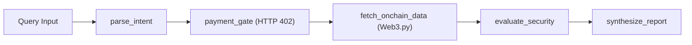

# Onchain Agent Sentinel — Project Summary

**Repository:** [https://github.com/DeshDeepakKant/onchain-agent-sentinel](https://github.com/DeshDeepakKant/onchain-agent-sentinel)  
**Author:** Desh Deepak Kant ([@DeshDeepakKant](https://github.com/DeshDeepakKant))  
**Primary Stack:** Python 3.12, LangGraph, Web3.py, FastAPI, HTTP-402 Protocol  

---

## 1. What Is It?
**Onchain Agent Sentinel** is an autonomous AI agent framework designed for **on-chain contract forensics** and **HTTP-402 agentic micropayment settlement**. 

It enables AI agents to inspect Ethereum smart contracts and wallets deterministically, while introducing non-custodial cryptographic payment challenges before running high-compute audits.

---

## 2. Core Problem Solved
1. **Agent Autonomy & Payment Walls:** Autonomous agents cannot hold credit cards or navigate human checkout flows. They need a protocol-level payment standard to autonomously compensate APIs and peer agents per inference call.
2. **Deterministic On-Chain Verification:** LLMs hallucinate contract behavior. Onchain Agent Sentinel uses deterministic RPC inspection (`web3.py`) to verify bytecode, balances, and transaction history before providing security recommendations.

---

## 3. How It Works (Pipeline)

1. **`parse_intent`:** Extracts target EVM addresses, target network (Mainnet / Sepolia / Base), and task classification.
2. **`payment_gate`:** Issues an HTTP-402 challenge requiring a micropayment receipt for high-compute risk audits. Standard checks bypass the gate.
3. **`fetch_onchain_data`:** Directly queries EVM RPC providers for native balances, nonce/transaction count, and bytecode length.
4. **`evaluate_security`:** Runs rule-based heuristics to identify contract proxies, unverified stubs, and account dormancy.
5. **`synthesize_report`:** Combines the execution trace and metrics into an auditable intelligence report.

---

## 4. Key Highlights
- **State Machine Orchestration:** Built with `langgraph.graph.StateGraph` using typed state (`AgentState`) and conditional branching.
- **Protocol-First Micropayments:** Implements the HTTP-402 standard with cryptographic challenge hashes (`SHA-256`) and receipt verification.
- **Dual Interfaces:** Usable as an interactive command-line tool (`python -m api.main`) or as a production REST API (`uvicorn api.main:app`).
