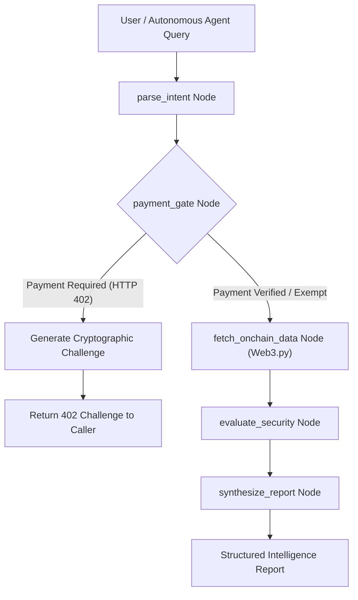

# Onchain Agent Sentinel 🛡️🤖

> **Autonomous LangGraph State Machine for On-Chain EVM Forensics & HTTP-402 Agentic Settlement**

[](https://www.python.org/downloads/)
[](https://github.com/langchain-ai/langgraph)
[](https://github.com/ethereum/web3.py)
[](https://opensource.org/licenses/MIT)

---

## 📌 Overview

As autonomous AI agents begin executing multi-step workflows across systems, they hit two critical barriers:
1. **Lack of Native Trust & Auditing:** Agents interacting with smart contracts need verifiable, deterministic on-chain data verification rather than hallucinated assumptions.
2. **Missing Payment Rails:** Agents cannot hold traditional corporate cards. They require native, trustless micropayments where upstream APIs or specialist sub-agents can challenge callers via **HTTP-402 (Payment Required)** and verify cryptographic settlement onchain.

**Onchain Agent Sentinel** solves this by pairing a deterministic **LangGraph state machine** with **EVM RPC providers (`web3.py`)** and an **HTTP-402 micro-settlement gate**.

---

## 🏗️ Architecture



---

## ⚡ Core Features

- **LangGraph State Orchestration:** Modular, traceable pipeline with state schema validation (`AgentState`).
- **Deterministic EVM Integration:** Interacts directly with Ethereum Mainnet, Sepolia, and Base using `web3.py` for bytecode extraction, balance checks, and contract/EOA classification.
- **HTTP-402 Settlement Primitive:** Issues cryptographic challenges requiring micropayment receipts before unlocking high-compute security audits.
- **Security Heuristics:** Automated rule evaluation identifying minimal proxies, unverified contract stubs, or high-risk transaction dormancy.
- **Dual Interfaces:** Ready-to-run interactive CLI runner and production-ready FastAPI endpoints with automated OpenAPI schemas.

---

## 🚀 Quickstart

### 1. Installation

```bash
git clone https://github.com/DeshDeepakKant/onchain-agent-sentinel.git
cd onchain-agent-sentinel

python3 -m venv .venv
source .venv/bin/activate
pip install -r requirements.txt
```

### 2. Environment Configuration

Copy `.env.example` and customize RPC URLs if desired (defaults to public RPC endpoints):

```bash
cp .env.example .env
```

### 3. Run via CLI

```bash
python3 -m api.main "Audit security of 0xd8dA6BF26964aF9D7eEd9e03E53415D37aA96045 on mainnet"
```

### 4. Run REST API

```bash
uvicorn api.main:app --reload --port 8000
```
Interactive API documentation available at `http://localhost:8000/docs`.

---

## 🧪 Testing

Execute test suite with pytest:

```bash
pytest tests/ -v
```

---

## 👨‍💻 Author

* **Desh Deepak Kant** ([@DeshDeepakKant](https://github.com/DeshDeepakKant))
* Email: [deshdeepakkant@gmail.com](mailto:deshdeepakkant@gmail.com)

---

## 📄 License

This project is licensed under the [MIT License](LICENSE).
